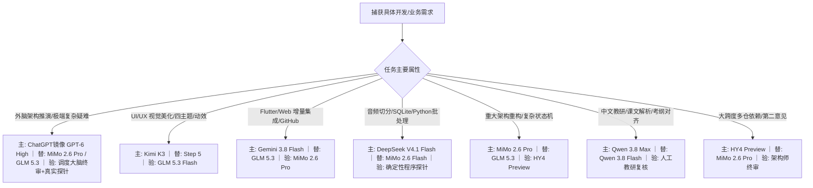

# 全维度 AI 模型智力评分榜与推荐调度总则

> **生效日期**：2026-10-11（郭老师定调升级）  
> **体系定位**：**记忆全局唯一公共真源（SSOT）**。无论用户在哪个 Agent（Trae、Claude、Codex、Gemini、QClaw 等）的交互窗口提问模型选型、评测对比或派发任务，**所有 Agent 与各业务子项目统一以本文档为唯一客观标准**，绝对禁止在子项目私设模型筛选规则。  
> **数据来源**：  
> **A. 能力面（决定"谁更强"，只有这两个）**  
> 1. **本地每日快照**：[[reference_AA全球模型每日量化快照]]（AA 量化大榜 · 综合智力指数 + 价格 + TPS + TTFT · 每日 01:00 自动落盘；生冷快照与趋势摘要**一律只留 7 天**，超期每日自动删除）  
> 2. **在线第一主榜**：https://arena.ai/leaderboard（LMSYS 竞技场 · 人类盲测胜率与硬核编程 Elo）—— 🔴 **只能人工看，无自动抓取**：2026-10-19 实测 `/leaderboard`、`/api/leaderboard`、`lmarena.ai` 等 6 个端点**全部 403**，整站有访问控制，脚本抓不到。  
>
> **B. 热度面（只回答"业内最近在关注什么"，**不用于能力比较**）**  
> 3. 中文资讯热度：[[reference_aihot_每日热度快照]]（AIHOT · 每日 01:10 自动落盘 · 冷快照 7 天 TTL）  
>    🔴 **口径更正（2026-10-19）**：AIHOT **不是模型能力榜**，它的 OpenAPI 里 27 个端点**没有一个 leaderboard**，官方自述为「中文 AI 资讯站」。它只反映新闻热度/声量。  
>    ⚠️ **原「在线第二主榜·AIHot 热榜」的说法是误判，已作废**——拿声量当能力会导致错误选型。  
> 4. 学术工程基准：SWE-bench Verified / GPQA Diamond / MMLU-Pro ＋ API 转发网关（`:3100`）实测动态探针。

---

## 一、 全局统领口诀与定调

> **核心口诀**：  
> **Kimi K3 管视觉，Gemini Flash 管集成，DeepSeek Flash 管数据，MiMo Pro 管复杂问题，GLM 管质量。**  
> **ChatGPT 镜像（GPT-6 Chat High）作外脑顶配特遣队，专攻跨架构极限推演与重难点问诊！**  
> **Muse Spark 1.3 Free 作极速高吞吐免费主力，175 TPS 极速读长文与海量批量生成！**  
> **高配模型搞规划，低配模型搞执行；先出成果供体验，后谈合规与缝补。**

### 核心分工总则
1. **打破单模型通吃**：按任务内在属性分配最匹配的模型，不搞盲目追高，杜绝大炮打蚊子；
2. **高低配协作流水线**：外脑顶配特遣队（ChatGPT 镜像 GPT-6 High）与端内旗舰（MiMo 2.6 Pro / GLM 5.3 / Qwen 3.8 Max）写架构、出方案、定标准；高吞吐低消耗模型（DeepSeek V4.1 Flash / Muse Spark 1.3 Free / Gemini 3.8 Flash）搬砖、写代码、跑批处理；
3. **成果体验第一**：AI 之间传递代码与 diff，呈报给郭老师的一律是**可点击、可交互、可安装体验的真实成果（新版截图/前后差异/一个明确的拍板选项）**，坚决消灭几千字文字流水账；
4. **全局唯一真源制（SSOT）**：所有子项目（如 English-Content-Factory、AI精听训练器、小红书点赞分析等）如需选模型，只保留指向本总则的指针，禁止另设模型标准。

---

## 二、 多维度客观智力评分榜与 LMSYS 竞技场数据对照

本表融合人类盲测 Elo（实际使用体感与审美）与真实工程解决率（硬核编程与深度推理）：

| 模型名称 | LMSYS Arena Coding Elo | LMSYS Hard Prompts | SWE-bench Verified (工程解决率) | GPQA Diamond (高难度推理) | 上下文窗口 (Context) | 核心王牌单项与实操优势 |
| :--- | :---: | :---: | :---: | :---: | :---: | :--- |
| **ChatGPT 镜像: GPT-6 (Chat High)** | **~1595** | **~1430** | **62.5%** | **74.8%** | 128K~1M | **外脑顶层架构仲裁与极端疑难问诊**：OpenAI 顶配推理主力，镜像站 Chat 标签默认项 `6`（推滑杆至顶档 `High`），专攻全项目全局顶层推演、跨系统重大方案终审、死锁裁决。 |
| **MiMo 2.6 Pro** | ~1565 | ~1380 | 54.8% | 68.2% | 1M+ | **小米旗舰级复杂长程工作流**：超长上下文无损推理，多模态协同，擅长跨模块复杂状态机与端内架构审查。 |
| **Kimi K3** | ~1558 | ~1365 | 52.3% | 65.4% | 2M | **前端视觉与审美天花板**：WebDev/Frontend 专项前列，四主题设计、组件布局、微动效、长真题研读。 |
| **GLM 5.3** | ~1560 | ~1375 | 53.9% | 67.5% | 128K | **硬核代码审查与长程攻坚**：智谱旗舰代码与复杂推理，擅长重大 PR 深度复审与疑难 Bug 竞争。 |
| **Muse Spark 1.3 Free** | **~1548** | **~1345** | **49.5%** | **63.8%** | **1.0M** | **极速高吞吐 Free 主力（TPS 175.3 极速天花板）**：Meta 超轻快旗舰，AA 智力指数 48.1，1M 超大上下文，输出速度 175.3 tok/s 全场极速！完全免费，极速读长文长文档、海量批量生成与快速审查。 |
| **Gemini 3.8 Flash** | ~1545 | ~1340 | 48.6% | 62.8% | 1M | **日常工程主力 Builder**：专为多文件工程与长程 Agent 优化，GitHub 协同、上下文缓存极速、稳定不掉链。 |
| **DeepSeek V4.1 Flash** | ~1540 | ~1335 | 47.2% | 61.5% | 128K | **高吞吐数据工程师**：极速响应（>90 tok/s），Python、SQLite、音频切分脚本、算法处理与正则清洗。 |
| **GLM 5.3 Flash** | ~1532 | ~1320 | 44.5% | 58.7% | 128K | **视觉质检与交付回归**：多模态图像理解敏锐，截图像素级比对、布局对齐、移动端溢出质检。 |
| **HY4 Preview** | ~1550 | ~1350 | 50.1% | 64.2% | 1M+ | **百万上下文大仓库宏观巡检**：腾讯全场景旗舰，大跨度宏观调用链审查、复杂方案第二意见（Second Opinion）。 |
| **Qwen 3.8 Max** | ~1555 | ~1360 | 51.7% | 66.0% | 128K | **中文权威与学术考纲终审**：通义千问超大模型，新课标考纲对齐、双释义精炼、教学设计权威把关。 |
| **Qwen 3.8 Flash** | ~1520 | ~1305 | 42.0% | 56.4% | 128K | **中文教研编辑**：课文解析、练习题生成、小红书高点击种草文案、轻量文案批量润色。 |
| **Step 5 Preview** | ~1538 | ~1330 | 45.8% | 60.1% | 128K | **交互创新与原型设计**：概念型原型、未来感界面、截图驱动实验（与 Kimi K3 竞争交互方案）。 |
| **GPT-5 全系 (镜像)** | — | — | — | — | — | ⚠️ **下线淘汰项**：郭老师 2026-10-11 裁定 **GPT 只考虑 GPT-6 系列**，GPT-5.6 Sol / GPT-5.5 全面淘汰不再列入候选。 |
| **Space Bunny** | — | — | — | — | — | **实验候选席**：公开预览已于 10-05 结束，底层实调不确定，暂不进入生产链。 |

> ⛔ **镜像站 Work 标签禁止使用说明**：2026-10-11 实测确认，镜像站 `Work` 标签连接 Codex 且本账号无权限，连发「1+1」或「你好」均被系统以安全理由彻底拦截（`This content can't be shown for safety reasons`）。因此 **`Work` 标签下的所有模型（含 GPT-6 Astra Max 等）一律禁止调用**，所有外脑任务坚决走 **`Chat` 标签 + 顶档 `High`**。

---

## 三、 API 转发网关（:3100）实战经验与三档动态路由

在 `API转发网关`（`:3100`）的真实生产运行中，形成了成熟的渠道准入与三档分层机制：

### 1. 准入硬红线（铁律）
- **能力硬底线**：必须是通用模型且综合能力 **> Qwen 27B 档（严格大于）**；
- **免费额度门槛**：免费日额度（RPD）**必须 > 50 次**才进常驻编排（低于 50 次仅支持显式单点调用）；
- **每日巡检防失效**：每日 00:23 自动巡检全量成员，剔除伪免费与坏通道，确保调用 100% 畅通。

### 2. 网关三档通道工程映射表

| 网关通道分层 | 性能指标 | 编排代表模型 | 最适合承接的工程业务 |
| :--- | :--- | :--- | :--- |
| **`free-fast`** (极速轻任务) | 响应延迟 < 1s 吞吐 ≥ 90 tok/s | DeepSeek V4.1 Flash MiMo 2.6 Flash | • 17,000+ 真题词次大数据清洗 • 音频逐字毫秒时间戳校验 • 批量 JSON Schema 格式验证 • 自动化测试脚本批量执行 |
| **`free-balanced`** (通用主力工程) | 响应延迟 1~2s 吞吐 50~90 tok/s | Gemini 3.8 Flash GLM 5.3 Flash | • 日常代码增量维护与多文件重构 • GitHub 提交、CI/CD 与工作流集成 • 前后端界面截图比对与视觉回归质检 • 知识库、看板组件维护 |
| **`free-heavy`** (深度推理重任务) | 深度思维链 高算力长程推理 | MiMo 2.6 Pro GLM 5.3 Qwen 3.8 Max | • 复杂跨模块状态机与异步死锁排查 • 重大 PR 架构审查与全项目影响面分析 • 新课标考纲学术对齐与教材级标准裁决 • 颠覆性重构方案预研 |

---

## 四、 ChatGPT 镜像站与外脑特遣队实战规范（2026-10-11 实测真源）

在 ChatGPT 镜像站（`https://ai.wendabao-f.net/?utm_source=hidden-ncn` 与 `vip-XX.67673.live`）中，模型调度与账号分配须严格遵循 2026-10-11 实测边界与平台契约：

### 1. 通路与档位铁律
- **唯一可用标签：`Chat`**：实测确认 `Work` 标签连接 Codex 且本账号无权限，连发 1+1 都会被拦截，**严禁使用 Work 标签**；
- **唯一允许档位：顶档 `High`**：Chat 标签仅有 3 档（`0=Instant · 1=Medium · 2=High`），发问前必须通过 `to_chat_high.js` 将滑杆推至顶端，断言 pill 闭态显示为 **`High`**；**严禁在 Instant 或 Medium 提问**（横竖白烧一轮）；
- **发问必须过 `mode_gate`**：发问前最后一个动作必须断言 `mode_gate` 通过，页面刷新或切换窗口均会重置为 Instant，绝无“刚才切过”的侥幸。

### 2. 模型选型与生命周期（GPT 仅考虑 GPT-6 系列）
- **唯一主攻：`6`（GPT-6 / GPT-6 Sol 架构默认款）**：镜像站高级菜单展开后显示为单字符 `6`，是当前最高推理力默认项，作为外脑顶层架构仲裁、重大方案重构与极端死锁攻坚唯一选择；
- **GPT-5 全系彻底淘汰**：郭老师 2026-10-11 明确指示 **GPT 只考虑 GPT-6 系列**。`GPT-5.6 Sol` 与即将下线的 `GPT-5.5`（`Leaving on October 14`）全部移出候选体系，不再作为任何任务的主力或备选；
- **替补与二审机制**：外脑若遇不可用或需交叉验证，直接由端内最高智力旗舰（`MiMo 2.6 Pro` / `GLM 5.3`）承接，不再降级回退至 GPT-5。

### 3. 账号池特性与任务派发口诀
账号池页共 17 张卡（会员有效期至 2026-10-29），涵盖两大底层账号类型：
- **PROLITE 账号**（vip-31/27/32/30，底层 ChatGPT Pro）：
  - `deep_research` 额度约 5 倍（120 次 vs 25 次）；`image_gen` 额度约 8 倍（1000 次 vs 120 次）；
  - **最适合派发**：重活、超长方案推演、深度调研、生图；
- **PLUS 账号**（13 张卡，底层 ChatGPT Plus）：
  - 拥有 `file_upload` 与 `paste_text_to_file` 专项配额；
  - **最适合派发**：长文粘贴送审、文件上传分析；派活前用 `limits_progress` 检查配额，避开配额已尽的卡。

### 4. 轮次纪律与交付回读闸门
- **单窗口 ≤ 24 轮**：每 3 轮必须彻底解决一个任务；达到 24 轮必须带总结另开新窗口；
- **历史记录 ≤ 10 条**：保留最近 10 条，从最旧记录往上物理删除（可执行脚本 `scripts/prune_history.js`）；
- **交付凭证回读 (`delivery_readback`)**：收回复后必须回读 `delivery_id` + `core_tail` + `spec_tail` 三项完整凭证，缺少任一项判“材料未完整送达”，不采信也不得据此改代码。

---

## 五、 全业务场景模型智能推荐决策树

任何 Agent 在被人类或外部系统问及“选哪个模型”时，直接按以下场景输出标准三元组（主模型 / 替补 / 验收 / 执行约束）：

### 7 大核心场景执行卡（可直接复制用于派活）

#### 场景 1：外脑顶层架构审查、极端复杂逻辑推演与重大技术选型仲裁
- **主模型**：**ChatGPT 镜像 (GPT-6 Chat High)**（PROLITE 账号主攻）
- **替补模型**：MiMo 2.6 Pro ｜ GLM 5.3
- **验收角色**：调度大脑人工终审 ＋ 真实机器探针
- **执行硬约束**：发问必须走 Chat 顶档 High；发问前过 `mode_gate`；携带规范交付凭证；单窗口 ≤24 轮；凭证回读三项齐全后方可采纳。

#### 场景 2：Flutter / Web 界面美化与视觉重设计
- **主模型**：**Kimi K3**（视觉主力）
- **替补模型**：Step 5 Preview（原型对比）
- **验收角色**：**GLM 5.3 Flash**（截图对齐与溢出回归）
- **执行硬约束**：只修改表现层样式与组件结构；绝对保留现有数据流、核心接口与业务逻辑；禁止推倒重来。

#### 场景 3：代码日常维护、多文件集成与 GitHub 协同
- **主模型**：**Gemini 3.8 Flash**（主 Builder）
- **替补模型**：GLM 5.3
- **验收角色**：**MiMo 2.6 Pro**
- **执行硬约束**：基于现有仓库增量修改，提交前必须实际运行编译、`flutter analyze` 或本地测试套件。

#### 场景 4：音频切分、数据清洗、SQLite 课文入库与批处理
- **主模型**：**DeepSeek V4.1 Flash**（后端主力）
- **替补模型**：MiMo 2.6 Flash（批量格式标准化）
- **验收角色**：确定性代码探针（时间戳探针、数据对账脚本）
- **执行硬约束**：严格验证毫秒字戳与 SQLite 读写一致性，严禁伪造测试日志。

#### 场景 5：重大架构决策、复杂状态机与疑难 Bug 攻坚
- **主模型**：**MiMo 2.6 Pro**（旗舰长程）
- **替补模型**：GLM 5.3（深度代码竞争者）
- **验收角色**：HY4 Preview（宏观大仓库第二意见）
- **执行硬约束**：深入分析全项目影响面并拟定最小侵入性方案，郭老师拍板前不得擅自颠覆性重构。

#### 场景 6：中文教研、课文文案润色与新课标考纲对齐
- **主模型**：**Qwen 3.8 Max**（学术把关）
- **替补模型**：Qwen 3.8 Flash（内容编辑加工）
- **验收角色**：人工教研复核
- **执行硬约束**：保证考点与释义出处权威，释义高度克制（如中考单词最多 2 个释义），不破坏既有数据结构。

#### 场景 7：大跨度多系统依赖分析与宏观全局审查
- **主模型**：**HY4 Preview**（百万级上下文宏观理解）
- **替补模型**：MiMo 2.6 Pro
- **验收角色**：调度大脑人工综合仲裁
- **执行硬约束**：通盘检索跨仓库引用与潜在隐性耦合，输出清晰的依赖拓扑与风险清单。

---

## 六、 调度大脑与各 Agent 协作四铁律

1. **规则一：单文件唯一执行责任 Agent（禁止并发冲突）**  
   任何物理文件在同一时间只允许一个主执行 Agent 写入。不同模块采用独立 Git 分支隔离，共享中枢文件（如 `main.dart`、网关配置、路由表）由主集成统一协调。
2. **规则二：大模型审查意见 ≠ 机器测试通过（真实机器为王）**  
   大模型赞同方案不代表代码没有 Bug。真正的验收必须过**真实机器探针**：编译器 0 报错、`flutter test` 通过、SQLite 数据一致性断言、以及**物理真机（如小米 14）**实操体验。
3. **规则三：高级模型啃硬骨头，Flash 模型跑规模化（资源效益最大化）**  
   外脑特遣队（GPT-6 High）、MiMo 2.6 Pro、GLM 5.3、Qwen 3.8 Max 专用于疑难攻坚、重大设计与深度审查；大批量格式转换、日志规整、字戳校验一律走 Flash 模型，避免算力与成本浪费。
4. **规则四：结果先行，向郭老师汇报只给一个核心成果（拒绝长篇汇报）**  
   AI 之间内部传递代码、变更清单与测试日志；向郭老师汇报时，只展示直观的新版界面截图、前后差异和一个明确的拍板选项，拒绝长篇大论。

---

## 七、 记忆联动与版本溯源

- **关联记忆**：
  - [[参考/reference_全维度AI模型智力评分与推荐调度总则]]（本文档 · 全局 SSOT 真源）
  - [[反馈/feedback_agent_tiering_results_first]]（高低配分工 + 先成果后合规）
  - [[用户/传话筒铁律_与强模型协作准则]]（视强模型为高智力，传达效果不限制手段）
  - [[流程/workflow_网关渠道挑选与刷新策略]]（API 转发网关三档线与免费准入门槛）
  - [[项目/project_scheduler_role_matrix]]（调度大脑派发矩阵）
  - [[项目/project_前端视觉重设计与多模型协同SOP]]（Kimi K3 视觉升级标准规范）
- **外脑特遣队契约与 Skill 关联**：
  - `D:\Work\元智能\10_AI自成长引擎\技能库\phrasing-external-model-review\components\gpt-mirror-extended-review\SKILL.md`（ChatGPT 镜像送审与自动化执行 Skill）
  - `D:\Work\元智能\20_自适应工作流引擎\contracts\gpt-mirror-extended-review.yaml`（契约与闸门体系）
  - `D:\Work\元智能\20_自适应工作流引擎\docs\runbooks\GPT镜像站Work模式模型与额度指南.md`（镜像站账号与额度指南）
- **项目落地真源映射**：
  - `English-Content-Factory/00_System/01_ListenLoop多模型团队分工方案_最新版.md`
  - `English-Content-Factory/02_Projects/HN-ENGLISH-666/03_Products/index.html`（交互式任务选择器）
  - `English-Content-Factory/02_Projects/HN-ENGLISH-666/03_Products/人机协同交互白板_LivingSurface.html`
  - `D:\Work\AI精听训练器\02_工程架构与系统设计\22_ListenLoop多模型团队分工方案.md`
